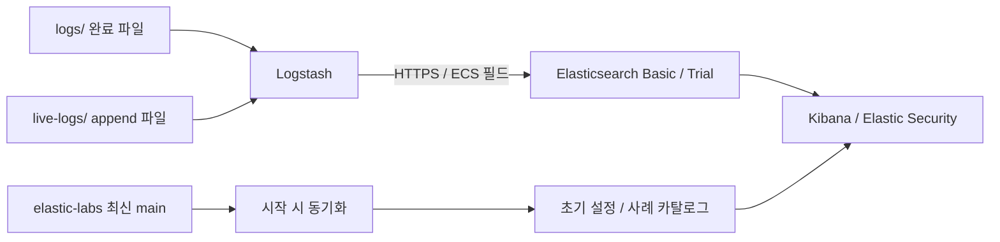

# Elastic Security SIEM lab

필요할 때 올리고, 분석이 끝나면 지우는 Docker Compose 기반 SIEM.
Elasticsearch → Kibana → 초기 설정 → Logstash 순서로 구성된다.
Elasticsearch·Kibana·Logstash는 `9.5.5`로 고정한다. 기본은 **무료 Basic**, 분석에 구독 기능이 필요하면 **Trial을 명시적으로 선택**할 수 있다.



> 공식 Docker 배포본은 Elastic License 2.0 기반이다. 무료 소스 부분의 AGPLv3 선택권과 공식 배포본의 라이선스는 구분해야 한다. 기본은 무료 Basic이며 Trial은 선택한 경우에만 공식 API로 활성화한다. [공식 라이선스 설명](https://www.elastic.co/pricing/faq/licensing)

## 1. 준비

- Docker Engine/Desktop + Docker Compose v2.20 이상
- Python 3.10 이상. 별도 pip 패키지 불필요
- Docker에 메모리 8GB 이상, 여유 디스크 15GB 이상 권장. 실제 로그 용량은 별도
- 최초 실행 시 Elastic 이미지 레지스트리, GitHub, Elastic Package Registry 접근 필요
- 로컬 설정 검사에는 Ruby + minitest, Logstash 설정 검사에는 OpenSSL도 필요

```bash
python3 builder.py init
```

- `.env`: 임의 생성한 서비스 비밀번호와 Kibana 암호화 키. Git에서 제외, 최초 생성 권한 `0600`
- `.state/instances.yml`: 인증서 SAN 입력
- `logs/`: 수집할 완료된 파일
- `live-logs/`: 계속 추가되는 파일

`.env`에서 포트, 메모리, TLS 추가 IP/DNS를 수정할 수 있다. 비밀번호는 최초 생성 값을 유지한다. 데이터 볼륨이 남아 있는 상태에서 `ELASTIC_PASSWORD`만 바꾸면 기존 계정 비밀번호는 변경되지 않는다.

## 2. 실행

```bash
python3 builder.py up
```

매번 다음 과정을 실행한다.

1. elastic-labs의 `main`을 최신 커밋으로 확인하고 소스·카탈로그 갱신
2. CA와 Elasticsearch 인증서 생성. 기존 인증서는 재사용
3. Elasticsearch 시작 및 상태 확인
4. `kibana_system`, 수집 전용 `logstash_internal` 계정 설정 및 선택한 라이선스 확인·활성화
5. Kibana 시작 및 상태 확인
6. 인덱스 템플릿, ingest pipeline, 데이터 뷰, 탐지 엔진 인덱스, 사전 정의 규칙, Labs 대시보드 적용
7. Logstash 시작 및 상태 확인
8. 호스트에서 CA 검증 연결 및 선택한 라이선스 재확인

실패한 단계가 있으면 종료 코드가 0이 아니며, 최초 실행에서는 다음 단계를 시작하지 않는다. 이미 실행 중이던 서비스가 있으면 자동으로 지우지 않는다. 재실행으로 설정을 다시 적용하거나 `down`으로 중지한다.

| 접속 | 주소 / 계정 |
| --- | --- |
| Kibana / Security | `http://localhost:5601/app/security` |
| Elasticsearch REST | `https://localhost:9200` |
| Labs 사례 목록 | `http://localhost:5601/app/dashboards#/view/elastic-labs-catalog` |
| 사용자 | `elastic` |
| 비밀번호 | `.env`의 `ELASTIC_PASSWORD` |
| Elasticsearch CA | `.state/ca.crt` |

비밀번호를 화면에 출력하지 않으므로 `.env`에서 확인한다. `.env` 전체나 `docker compose config`의 전체 출력을 공유하지 않는다.

### Trial 선택

```bash
# 이 실행에서 공식 Trial 활성화. 이후 재시작에도 같은 옵션 사용
python3 builder.py up --trial
```

매번 옵션을 지정하지 않으려면 `.env`에 `LICENSE_MODE=trial`을 설정한다. 기본값은 `basic`이다. 이미 활성화된 Trial은 재사용하고 만료일을 출력한다. Basic 모드로 실행했다고 기존 Trial을 자동으로 다운그레이드하지 않는다.

Trial은 30일 동안 구독 기능을 사용할 수 있으며, 공식 API의 활성화 가능 여부에 따라 동작한다. 같은 클러스터에서는 메이저 버전당 한 번만 활성화할 수 있다. 사용 불가·만료·활성화 거부 시 원인을 출력하고 중단한다. 라이선스 상태를 초기화해서 제한을 우회하거나 Basic으로 조용히 전환하지 않는다. [공식 Trial API](https://www.elastic.co/docs/api/doc/elasticsearch/operation/operation-license-post-start-trial)

Trial은 기능을 사용할 수 있는 라이선스를 제공한다. Elastic Agent/Endpoint 등록, ML 작업, 외부 모델 연결, 실제 로그에 맞는 탐지 규칙 활성화까지 자동 구성하는 옵션은 아니다.

### 초기 설정 내용

- `xpack.security.enabled=true`, API key 활성화, Elasticsearch HTTP/transport TLS
- Kibana 암호화 키 유지. 탐지 엔진 초기화에 필요한 설정 적용
- `logs-lab-*` ECS 중심 인덱스 템플릿, 1 shard / 0 replica
- `lab-ingest` pipeline: `event.ingested`에 수집 시각 기록
- 기본 데이터 뷰 `Lab logs`, Security 검색 대상에 `logs-*` 포함
- 현재 Stack과 호환되는 최신 prebuilt rules 설치/갱신
- Logstash의 Elasticsearch 계정은 `logs-lab-*` 쓰기 권한만 부여

**신규 prebuilt rules는 비활성 상태로 설치된다.** Security → Detection rules (SIEM)에서 실제 데이터에 맞는 규칙을 선택해 활성화한다. 이미 활성화한 규칙은 업데이트 시 상태를 유지한다. Basic 모드에서는 ML 등 구독 기능이 필요한 규칙을 제외한다. Trial 모드에서도 ML 작업과 데이터 소스 등 개별 기능의 설정은 별도로 필요하다. 자동 설치를 끄려면 `.env`의 `PREBUILT_RULES=false`로 설정한다.

## 3. 로그 넣기

완료된 UTF-8 텍스트 파일, NDJSON/JSONL 파일을 `logs/` 아래에 넣으면 하위 디렉터리까지 검색한다. read 모드라 마지막 줄에 개행이 없어도 수집한다. `.gz`로 압축한 줄 단위 로그도 지원한다.

```bash
# 복사 중인 파일이 먼저 읽히지 않도록 .partial로 준비한 다음 이름 변경
cp /path/to/auth.log logs/auth.log.partial
mv logs/auth.log.partial logs/auth.log
```

약 5초의 파일 탐색 주기 + 처리/인덱스 refresh 시간 후 조회할 수 있다. `.tmp`, `.partial`, `.gitkeep`, `README*`, `.DS_Store`는 제외한다. 컨테이너 UID 1000이 파일을 읽고 디렉터리를 탐색할 수 있어야 한다.

| 입력 형식 | 처리 |
| --- | --- |
| 일반 텍스트 | 한 줄 = 한 이벤트. `message`, `event.original` 보존 |
| ECS JSON 한 줄 | `host`, `source`, `event`, `process` 등 구조 유지 |
| JSON `@timestamp` | ISO8601 해석. 없거나 해석 실패하면 수집 시각 사용 |
| 잘못된 JSON | 원문 보존 + `lab_json_parse_failure` 태그 |
| JSON 배열 / 여러 줄 JSON | 자동 분할하지 않음. 입력 전에 NDJSON으로 변환 |
| 비 ECS scalar 필드 | 객체와 충돌하는 필드는 `lab.unmapped`에 보존 |

예시 ECS JSONL 형식:

```json
{"@timestamp":"2026-10-29T02:00:00Z","message":"Failed SSH login","event":{"category":["authentication"],"type":["start"],"outcome":"failure","dataset":"system.auth"},"host":{"name":"test-host"},"source":{"ip":"192.0.2.10"},"user":{"name":"alice"}}
```

일반 텍스트도 바로 검색할 수 있지만, 모든 제품의 텍스트 로그를 자동으로 ECS로 변환하지는 않는다. 탐지 규칙이 요구하는 필드는 해당 제품용 grok/dissect 또는 JSON 변환을 `config/logstash/pipeline/`에 추가해야 한다. Windows EVTX, 바이너리, CSV, 여러 줄 stack trace는 먼저 줄 단위 텍스트/JSONL로 변환하거나 전용 파서를 추가한다.

계속 append되는 파일은 `live-logs/`에 둔다. 이 경로는 tail 모드로 동작하고, 각 이벤트 끝에 개행이 필요하다. 같은 파일을 양쪽 경로에 넣으면 중복 수집된다.

### 수집 상태 확인

Kibana Discover → `Lab logs` 데이터 뷰를 선택한다. 과거 로그는 우측 상단 시간 범위를 해당 시각으로 변경한다. Security의 기본 시간 범위 밖에 있는 로그도 같은 이유로 보이지 않을 수 있다.

```bash
python3 builder.py status
docker compose logs --tail=100 logstash
docker compose logs --tail=100 elasticsearch kibana

# 사용자가 실행하는 E2E 검사: 고유 테스트 이벤트 1건을 logs/에 생성
python3 builder.py smoke
```

`smoke`는 개행 없는 파일이 Logstash를 거쳐 Elasticsearch에 들어왔는지와 `event.ingested`를 확인한다. 임시 입력 파일은 삭제하지만 인덱스의 테스트 이벤트는 남는다.

Logstash는 persistent queue와 dead letter queue(DLQ)를 사용한다. 매핑 충돌로 거부된 이벤트는 DLQ에 들어갈 수 있으므로 오류가 있으면 Logstash 로그와 `lsdata`의 DLQ를 확인한다. 전송은 at-least-once이며 장애 경계에서 exactly-once를 보장하지 않는다.

## 4. 호스트 ↔ 컨테이너 네트워크

기본 `BIND_HOST=0.0.0.0`. 호스트의 모든 IPv4 인터페이스에 다음 포트를 공개한다.

| 포트 | 용도 |
| --- | --- |
| 9200/TCP | Elasticsearch HTTPS REST API |
| 9300/TCP | Elasticsearch TLS transport |
| 5601/TCP | Kibana HTTP |
| 5044/TCP | Logstash Beats 입력 |
| 5514/TCP, UDP | Logstash 텍스트 입력. TCP는 개행 구분 |

일반 Docker bridge를 사용하고 `internal` 네트워크, 애플리케이션 IP allowlist, outbound 차단을 추가하지 않는다. 컨테이너 → 호스트는 `host.docker.internal:<port>`를 사용한다. 호스트의 수신 서비스도 Docker에서 도달 가능한 주소에 listen해야 한다. OS 방화벽·VPN·회사 네트워크 정책은 이 저장소가 변경하지 않는다.

Kibana와 수집 포트는 기본 구성에서 평문이며, Beats/텍스트 입력은 인증이 없다. `0.0.0.0`으로 열었으므로 호스트에 접근 가능한 다른 장비도 연결할 수 있는 실습용 구성이다. Elasticsearch의 계정 인증과 TLS는 Security 기능을 위해 유지한다.

LAN 주소로 Elasticsearch를 검증 연결하려면 **첫 실행 전** `.env`에 해당 주소를 추가한다.

```dotenv
TLS_EXTRA_IPS=192.168.0.20
TLS_EXTRA_DNS=my-lab.example.test
```

구체적인 `BIND_HOST` IP는 SAN에 자동 포함된다. 기존 인증서 발급 후 SAN을 바꾸면 `up`이 불일치를 감지하고 중단한다. 데이터와 CA를 보존하며 leaf 인증서만 다시 만들려면:

```bash
python3 builder.py rotate-certs
python3 builder.py up
```

`rotate-certs`는 먼저 이 프로젝트를 중지한다. 다른 컨테이너나 호스트 인증서는 변경하지 않는다.

## 5. 중지 / 삭제 / 재사용

```bash
# 컨테이너·프로젝트 네트워크 삭제. 데이터와 수집 위치는 유지
python3 builder.py down

# 최신 Labs와 규칙을 갱신한 뒤 다시 시작
python3 builder.py up

# SIEM 데이터, 인증서, persistent queue, DLQ, sincedb까지 삭제
python3 builder.py destroy --yes

# 다운로드 캐시, .env, 로컬 생성 상태도 함께 삭제
python3 builder.py destroy --yes --purge-cache --purge-secrets
```

| 항목 | down | destroy | destroy + 두 purge 옵션 |
| --- | --- | --- | --- |
| 프로젝트 컨테이너 / 네트워크 | 삭제 | 삭제 | 삭제 |
| ES 인덱스 / Kibana 저장 객체 | 유지 | 삭제 | 삭제 |
| Logstash 수집 위치 / queue / DLQ | 유지 | 삭제 | 삭제 |
| 인증서 볼륨 | 유지 | 삭제 | 삭제 |
| `.env` / Labs 캐시 | 유지 | 유지 | 삭제 |
| 원본 `logs/`, `live-logs/` | 유지 | 유지 | 유지 |
| Docker 이미지 | 유지 | 유지 | 유지 |

원본 로그는 자동 삭제하지 않는다. `destroy` 후 다시 시작하면 남아 있는 원본 로그를 처음부터 다시 읽는다. 일반 `down`/`up`은 sincedb를 재사용하므로 기존 파일의 수집 위치를 이어간다. 완료 파일을 재수집하려면 새 파일로 복사하거나 데이터 삭제 후 재구축한다.

서비스는 `restart: "no"`이므로 Docker/호스트 재부팅 후 자동 상시 실행하지 않는다. 사용자가 `up`을 실행할 때 시작한다. 호스트 전역 prune, 방화벽 수정, `vm.max_map_count` 변경은 하지 않는다. 실습 환경에서는 `node.store.allow_mmap=false`를 사용한다.

이미지까지 제거하려면 이 프로젝트를 삭제한 후 해당 이미지 세 개만 `docker image rm`으로 지정한다. 다른 프로젝트도 같은 이미지를 사용할 수 있어 자동 삭제 대상에는 포함하지 않았다.

## 6. elastic-labs 최신 업데이트

원본: [elastic/elastic-labs](https://github.com/elastic/elastic-labs)

`up`은 매번 `main`의 SHA를 조회한다. 이전 SHA와 같으면 다운로드를 생략하고, 달라졌으면 새 소스·manifest·catalog를 만든 다음 하나의 포인터를 원자적으로 교체한다. 실패하면 이전 캐시를 최신인 것처럼 사용하지 않고 종료한다.

| 경로 | 내용 |
| --- | --- |
| `.cache/elastic-labs/source/` | upstream 소스 전체 |
| `.cache/elastic-labs/manifest.json` | 원본 URL, 고정 커밋, 동기화 시각, 아카이브 해시 |
| `.cache/elastic-labs/catalog.json` | Security / Observability / Search·AI 사례 목록 |
| Kibana `Elastic Labs — latest examples` | 초기 설정 시 반영되는 사례·revision 대시보드 |

이 저장소에는 모든 사례에 공통으로 적용할 SIEM 설정 묶음이 없다. 노트북, 앱, 가이드마다 데이터와 의존성이 다르므로 소스·사례 목록을 갱신하고, upstream 설치 스크립트나 노트북을 자동 실행하거나 샘플 데이터를 자동 주입하지 않는다. Basic을 넘는 기능이나 외부 모델 API가 필요한 사례는 별도 구성이 필요하다. 사전 정의 탐지 규칙은 elastic-labs와 별도로 Kibana의 공식 규칙 패키지에서 갱신한다.

```bash
# 컨테이너 실행 없이 소스·카탈로그만 갱신. Kibana 반영은 다음 up에서 수행
python3 builder.py sync-labs

# 인터넷 없이 이미 검증한 Labs 캐시 사용. 이미지와 규칙 패키지는 별도 필요
python3 builder.py up --offline

# 실험 재현용 커밋 고정. 이후 실행에도 같은 --ref를 전달
python3 builder.py up --ref <40자리-commit-sha>
python3 builder.py up --offline --ref <40자리-commit-sha>
```

`--offline`은 **Labs 소스만** 오프라인으로 재사용한다. 최초 prebuilt rules 설치에는 Package Registry 연결이 필요하므로 완전 오프라인 기동은 사전 다운로드한 이미지와 `PREBUILT_RULES=false`가 필요하다. Labs 캐시가 없거나 지정한 ref가 다르면 실패한다.

Stack 자체는 데이터 호환성을 위해 시작할 때 자동 업그레이드하지 않는다. `.env`의 `STACK_VERSION`을 같은 안정 버전으로 통일해서 변경한다. 일회용 환경의 버전 변경은 `destroy` 후 새 버전으로 재구축하는 방식을 권장한다. 기존 볼륨의 다운그레이드는 지원하지 않는다.

`builder.py` 실행 시 공식 Elasticsearch GitHub 릴리스에서 새 안정 버전이 있는지 확인하고 안내한다. 버전 확인은 정보 제공용으로, `.env`, 이미지 태그, 기존 데이터를 바꾸지 않는다. 릴리스 전 빌드가 포함될 수 있는 artifacts 목록을 최신 안정 버전의 기준으로 사용하지 않는다.

조회 결과는 24시간 캐시하며 네트워크 오류는 구축·삭제 명령을 막지 않는다. `--offline` 실행에서는 버전 조회도 캐시만 사용한다.

```bash
# 캐시를 갱신하여 릴리스 확인
python3 builder.py version

# 이번 실행에서 버전 조회 생략 (CI 등)
python3 builder.py --no-version-check check
```

## 버전 태그

기준 브랜치는 [dollce/analyzer-siem의 master](https://github.com/dollce/analyzer-siem)이다. 병합된 변경을 Elastic Stack 버전 기준의 annotated tag로 관리한다.

- 해당 Stack의 첫 프로젝트 릴리스: `elastic-v9.5.5`
- 같은 Stack에서 코드만 수정한 후속 릴리스: `elastic-v9.5.5-r2`, `-r3`, …
- 기존 공개 태그를 이동하거나 덮어쓰지 않는다.

태그는 이 프로젝트의 설정·코드를 식별한다. Elastic upstream 릴리스나 실행 중인 클러스터의 자동 업그레이드를 의미하지 않는다.

## 7. 검증

```bash
# Compose 파싱, 초기화/API mock·아카이브 처리·파서 단위 테스트
python3 builder.py check

# 실제 Logstash 이미지로 설정 컴파일. --network none, 입력 로그 없음
bash scripts/check_logstash.sh

# 사용자가 SIEM을 기동한 후 실제 수집 검증
python3 builder.py smoke
```

CI도 앞의 두 검사만 수행한다. SIEM 초기화나 runtime fixture ingestion은 CI에 포함하지 않는다.
단위 테스트와 설정 컴파일은 실제 SIEM 기동·수집 성공을 보증하지 않는다. 운영 환경에서 수집 경로를 검증하려면 기동 후 `smoke`를 실행한다.

## 참고

- [동일 Stack 버전 요구사항](https://www.elastic.co/docs/deploy-manage/deploy/self-managed/installing-elasticsearch)
- [Elastic Security 탐지 기능 활성화 조건](https://www.elastic.co/docs/solutions/security/detect-and-alert/turn-on-detections)
- [Logstash file input — read/tail, EOF, sincedb](https://www.elastic.co/docs/reference/logstash/plugins/plugins-inputs-file)
- [Prebuilt rules 설치 API](https://www.elastic.co/docs/api/doc/kibana/operation/operation-installprebuiltrulesandtimelines)
- [Elasticsearch 원본](https://github.com/elastic/elasticsearch)
